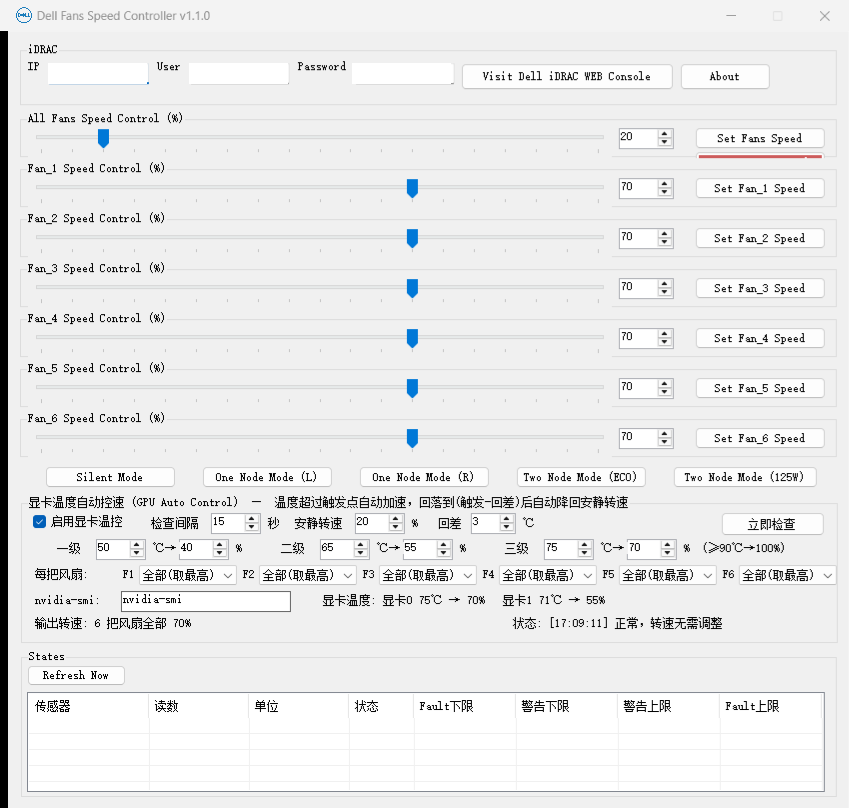
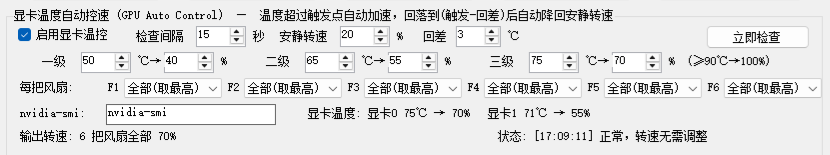

# dell_fans_controller
a tool for adjust Dell Server fans speed

# 戴尔服务器风扇转速控制工具
工作原理：借助 ipmitool for windows 命令行工具对风扇进行转速调整。ipmitool 是通过戴尔服务器的 IPMI 功能进行控制，因此要求服务器首先开启 IPMI over LAN 功能，具体操作方式请参考该文章 https://zhuanlan.zhihu.com/p/157796567 

本仓库在原版（只能手动拖滑块 / 预设模式）的基础上增加了 **v1.1.0：显卡温度自动控速**——程序定时读本机显卡温度，温度升高自动加速，温度回落自动降回安静转速。

---

# 最新版下载地址 (Latest Release Download Link)

## V1.1.0（显卡温度自动控速版）

- **免安装包（推荐，2.6 MB）**：[Dell_Fans_Controller_v1.1.0_full.zip](https://github.com/www902/dell_fans_controller/releases/download/v1.1.0/Dell_Fans_Controller_v1.1.0_full.zip)
  解压后同一个文件夹里已经有 `dell_fans_controller.exe`、`ipmitool.exe` 和 4 个 cygwin dll，双击 exe 就能打开；再按里面的 `guide_v1.1.0.txt` 填 iDRAC 的 IP / 用户名 / 密码。
- Release 页面（含上面这个压缩包和单独的 exe）：https://github.com/www902/dell_fans_controller/releases/tag/v1.1.0
- 只要主程序：[dell_fans_controller_v1.1.0.exe](https://github.com/www902/dell_fans_controller/releases/download/v1.1.0/dell_fans_controller_v1.1.0.exe)
  （需要自己把 `ipmitool.exe` 及它的 cygwin dll 放在同一个目录，本仓库 `dell_fans_controller/Dell/SysMgt/bmc/` 下有）
- 想自己编译：仓库根目录执行 `build.cmd`，或用 Visual Studio 打开 `dell_fans_controller/dell_fans_controller.sln`
- 用法全部写在下面，重点只看一句：**打开程序 → 勾选「启用显卡温控」**

## V1.0.0
https://github.com/cw1997/dell_fans_controller/releases/download/v1.0.0/dell_fans_controller_v1.0.0.zip

---

# 界面（v1.1.0）



中间那块「显卡温度自动控速 (GPU Auto Control)」就是新增的面板：



---

# v1.1.0 新增功能：显卡温度自动控速

## 它做了什么

```
每 N 秒（默认 15 秒）：
  nvidia-smi --query-gpu=index,name,temperature.gpu,fan.speed --format=csv,noheader,nounits
      ↓ 每块显卡按温度分档（带回差，不会来回抖动）
      ↓ 每把风扇按「绑定关系」取它该用的档位（默认 6 把都取所有显卡里的最高档）
      ↓ 和上次实际下发的值比较，只有变化时才写 iDRAC
  ipmitool -I lanplus -H <ip> -U <user> -P <pass> raw 0x30 0x30 0x01 0x00        # 退出自动风扇模式
  ipmitool -I lanplus -H <ip> -U <user> -P <pass> raw 0x30 0x30 0x02 <fan> <pct> # 设置某把风扇转速
```

档位（默认值，界面上都能改）：

| 显卡温度 | 风扇转速 |
| --- | --- |
| 所有显卡都低于一级触发点 | 安静转速（默认 20%） |
| ≥ 50℃ | 40% |
| ≥ 65℃ | 55% |
| ≥ 75℃ | 70% |
| ≥ 90℃ | 100%（保护） |

* 升温立刻升档；降温要低于「触发点 − 回差」才降档（默认回差 3℃），所以不会出现 40%↔55% 来回跳。
* 转速下限 10%、上限 100%，与原程序一致。
* 勾选状态、间隔、档位、绑定关系都会存进 `config.ini` 的 `[gpu]` 段，**开机自启后自动继续工作**。

## 使用说明（第一次用）

1. 服务器上开启 IPMI over LAN（iDRAC → Network → IPMI 通道，具体见上面那篇知乎文章）。
2. 准备一个目录，里面要有：`dell_fans_controller.exe`、`ipmitool.exe`（本仓库 `dell_fans_controller/Dell/SysMgt/bmc/` 下就有，连同它的 cygwin dll 一起复制）、`config.ini`。
3. `config.ini` 里填 iDRAC 信息（照抄 `config.ini.example` 改一下即可）：

   ```ini
   [ipmi]
   ip=192.168.1.10
   user=root
   password=changeme
   ```
4. 运行程序 → 最上面填 iDRAC IP / User / Password → 点 `Check IPMI Connection` 确认能通。
5. 勾选面板最左边的 **启用显卡温控**，就生效了；想停掉就取消勾选，或点下面的 `Reset to Auto Mode`（会同时取消勾选并把风扇交回 iDRAC 自动策略）。
6. 可选：把 exe 的快捷方式放进 `shell:startup`（开始菜单「启动」文件夹），实现开机自启。

## 面板参数

| 控件 | 含义 | 默认 |
| --- | --- | --- |
| 启用显卡温控 | 开关，状态会保存，下次启动自动恢复 | 关 |
| 检查间隔 | 读温度 + 调速的周期（秒） | 15 |
| 安静转速 | 所有显卡都低于一级触发点时用的转速 | 20% |
| 回差 | 降档用的温度余量，越大越不容易来回跳 | 3℃ |
| 一级 / 二级 / 三级 | 触发温度 → 转速 | 50→40 / 65→55 / 75→70 |
| 每把风扇 F1…F6 | 这把风扇听哪块显卡：`全部(取最高)` / `显卡1…4` / `不参与` | 全部(取最高) |
| nvidia-smi | nvidia-smi 路径，不在 PATH 里就填完整路径 | `nvidia-smi` |
| 立即检查 | 马上读一次并调速，调参数时很方便 | — |

面板下面两行是实时状态：

```
显卡温度: 显卡0 75℃ → 70%   显卡1 71℃ → 55%     每块显卡当前温度和它要求的档位
输出转速: 6 把风扇全部 70%                       实际下发给 iDRAC 的转速
状态: [17:09:11] 正常，转速无需调整
```

## 多块显卡分别控速

靠 F1…F6 下拉框。比如机箱里两块显卡各自有独立风道：把 F1/F2 绑到「显卡1」、F3/F4 绑到「显卡2」，
谁热就只提谁那一路的风扇。选 `不参与` 的那把风扇完全交给手动按钮，温控不会碰它。

原来的手动按钮（`Set Fan_x Speed`、Silent / One Node / Two Node）照样能用，只是下一个周期温控会按显卡
温度把转速覆盖回来，此时状态行会提示「手动设置了 xxx，显卡温控仍在使用」。

## 日志

每次因为显卡温度改变转速，都会在同目录 `gpu_control.log` 记一行：

```
2026-11-18 16:44:58  显卡温度 显卡0 64℃ → 40%   显卡1 61℃ → 40%  =>  输出转速: 6 把风扇全部 40%
```

## 实测（Dell PowerEdge R730xd，iDRAC8 2.86，2×Tesla T10）

| 阶段 | 显卡温度 | 程序下发转速 |
| --- | --- | --- |
| 启用前（6 把风扇手动 20%） | 84–86℃ | — |
| 勾选启用后约 1 分钟 | 76→71℃ | 70% |
| 温度回落后 | 67→64℃ | 55% → 40% |

「温度高→加速」「温度低→降回安静」两条都闭环生效，不需要人工干预。

一个坑：**iDRAC 的 `Fan1..Fan6` 传感器读数在这类机器上常常不随百分比变化**（这台一直显示 ~12700 RPM），
所以别用 `ipmitool sdr elist` 的转速读数判断有没有生效，看显卡温度变化和 `gpu_control.log` 更靠谱。

---

# 编译

## 方式一：命令行（不需要 Visual Studio，Windows 自带的 .NET Framework 4 就够）

```bat
build.cmd
```

它做三件事：

```bat
csc /nologo /target:exe /codepage:65001 /out:tools\mkres.exe tools\mkres.cs
tools\mkres.exe dell_fans_controller\dell_fans_controller\FormMain.resx dell_fans_controller\dell_fans_controller\FormMain.resources
csc "@build.rsp"
```

要点：

* `/codepage:65001`：源码里有中文注释和中文界面文字，少了这一条 csc 会解析失败。
* `/resource:...FormMain.resources,dell_fans_controller.frmMain.resources`：资源的逻辑名必须和
  `ComponentResourceManager(typeof(frmMain))` 推导出的名字**完全一致（含大小写）**，否则启动就抛
  `MissingManifestResourceException`。
* 没有 VS 的 `resgen.exe`，所以仓库里带了个 48 行的替代品 `tools/mkres.cs`。
* 新增的两个文件只用 .NET 2.0 运行时也有的 API，但 `.csproj` 的目标框架已从 v2.0 提到 v4.0（与发布版一致）。

## 方式二：Visual Studio

打开 `dell_fans_controller/dell_fans_controller.sln`，生成即可（`GpuProbe.cs`、`GpuFanControl.cs` 已经加进 `.csproj`）。

---

# 常见问题

* **读不到显卡温度**：`nvidia-smi` 不在 PATH，或机器上没有 NVIDIA 卡。在面板里填完整路径；读不到时状态行会写明原因，温控不会乱调。
* **风扇频繁变档**：把「回差」调到 5–8℃，或把相邻两档的触发温度拉大。
* **点 `Reset to Auto Mode`**：会取消勾选并关闭温控，风扇完全交回 iDRAC 自动策略。
* **想让显卡一直凉着**：把安静转速设高一点（例如 30%），或把一级触发点设成 40℃。
* **密码安全**：`config.ini` 里是明文密码（原程序就是如此），注意目录权限；仓库的 `.gitignore` 已忽略 `config.ini`，不要把带密码的配置提交上来。

---

# 本版本 (v1.1.0) 相对原版改了什么

| 文件 | 说明 |
| --- | --- |
| `dell_fans_controller/GpuProbe.cs`（新增） | nvidia-smi 读显卡温度/转速；带回差的温度→档位计算；ipmitool 下发转速 |
| `dell_fans_controller/GpuFanControl.cs`（新增） | 界面上的「显卡温度自动控速」面板、后台轮询线程、`config.ini` 的 `[gpu]` 段读写、`gpu_control.log` 日志 |
| `dell_fans_controller/FormMain.cs` | 承载面板；界面参数快照交给后台线程；UI 更新走 `BeginInvoke`；iDRAC 凭据即时同步；点手动按钮时给冲突提示；`Reset to Auto Mode` 时关闭温控；关窗时停线程；窗口高度按屏幕工作区自适应 |
| `dell_fans_controller/dell_fans_controller.csproj` | 加入两个新文件；目标框架 v2.0 → v4.0；设置 `dell.ico` 为程序图标 |
| `Properties/AssemblyInfo.cs` | 版本号 1.0.0.0 → 1.1.0.0 |
| `build.cmd` / `build.rsp` / `tools/mkres.cs`（新增） | 命令行编译，不需要 Visual Studio |
| `config.ini.example` / `docs/` / `release/`（新增） | 配置样例、界面截图、编译好的程序 |

源码基于 <https://github.com/cw1997/dell_fans_controller>（本仓库原始代码），界面代码取自
<https://github.com/zzccchen/DellEmcFansController>（v1.0.2，同为 Apache-2.0），在其之上完成本次改动，
改动清单见 `NOTICE`。许可为 Apache License 2.0，见 `LICENSE`。

> ⚠️ 提醒：直接写 iDRAC 风扇策略有风险。调速期间 iDRAC 的自动风扇保护被临时接管，请确认机器散热余量充足，
> 并保留 `Reset to Auto Mode` 这个退出手段。

---

# English (short version)

Windows fan-speed controller for Dell PowerEdge (iDRAC), now with **GPU-temperature-based automatic fan
control** (v1.1.0). It polls `nvidia-smi`, maps temperature to a fan level with hysteresis
(quiet floor 20%, 50℃→40%, 65℃→55%, 75℃→70%, 90℃→100%), then applies it with
`ipmitool ... raw 0x30 0x30 0x02 <fan-id> <percent>`. Each of the six fans can be bound to one specific
GPU or to "max of all GPUs", so multi-GPU servers can steer individual fans. Tick **启用显卡温控**
("enable GPU temperature control") to turn it on; the setting is saved in `config.ini`, so it keeps
working after a reboot. Build with `build.cmd` (.NET Framework 4 `csc.exe`) or open the `.sln` in Visual Studio.
